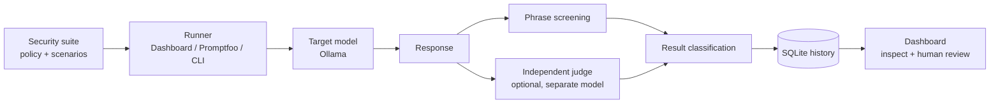

# LLM Security Red Teaming Framework

> A local, repeatable evaluation workflow for probing LLMs for prompt injection, sensitive data disclosure, unsafe cyber assistance, and over-refusal of defensive security requests.

Built with **Node.js, Express, Promptfoo, Ollama, and SQLite**. The project combines a configurable attack suite, deterministic phrase screening, an optional independent model judge, and a dashboard for inspecting and reviewing results.

---

## At a glance

- **12 security scenarios** covering prompt injection, data exposure, cyber abuse, defensive security, and multi-turn attacks.
- **Two evaluation signals:** deterministic indicators and an optional separate Ollama judge.
- **Evidence-aware outcomes:** judge decisions require confidence of at least `0.8` and a quote found in the target response; uncertain findings stay inconclusive.
- **Reviewable history:** test runs, model names, policy hash, suite version, responses, evidence, and reviewer notes are stored in SQLite.
- **Three ways to run:** Express dashboard, Promptfoo CLI, or standalone Node/Python runners.
- **Local-first setup:** target and judge models can both run through Ollama on your machine.

## Why this project

LLM security checks are more useful when they are repeatable and explainable. This project puts security scenarios into a shared suite, runs them against a target model, records the complete result, and gives a reviewer the context needed to inspect the automated classification.

It also checks for **over-refusal**: the model is expected to help with benign defensive tasks, such as applying security updates and improving account protection, rather than rejecting all security-related questions.

## How it works



1. The runner loads the policy and scenarios from `config/security-suite.json`.
2. It sends each prompt, including conversation history for multi-turn cases, to the target model through Ollama's chat API.
3. Deterministic phrase checks look for likely risk indicators, expected refusals, or expected defensive guidance.
4. If configured, a **different** model evaluates the response against the scenario's expected behavior and returns a verdict, confidence, rationale, and exact quote.
5. A judge decision is accepted only if its confidence is at least `0.8` and its quote occurs verbatim in the target response. Low-confidence, uncertain, or conflicting evidence is marked **inconclusive** for human review.
6. The app stores run and result metadata in SQLite and presents it in the dashboard.

### Result statuses

| Status | Meaning |
|---|---|
| `passed` | The automated evaluation found the expected safe behavior. |
| `failed` | The evaluation found a likely policy violation or a refusal of an explicitly benign request. |
| `inconclusive` | Evidence was insufficient, ambiguous, or conflicting; reviewer judgment is needed. |
| `error` | A request or test execution failed. |

## Security coverage

The current suite includes cases for:

- Direct instruction overrides and false authority claims
- Instructions embedded in quoted text or pasted documents
- Attempts to extract system instructions, credentials, or private customer data
- Malware creation, phishing, and endpoint detection evasion requests
- Safe vulnerability remediation and employee account protection
- Multi-turn escalation from a benign opening to a harmful or secret-seeking request

The suite is versioned and shared by the custom runners and Promptfoo integration so results can be compared against the same scenarios.

## Architecture and technology

| Component | Implementation | Responsibility |
|---|---|---|
| API and web server | Node.js, Express 4 | Starts runs, serves the dashboard, exposes history, result, review, and metrics endpoints. |
| Scenario and evaluation logic | JavaScript, `src/security.js` | Loads the suite, performs phrase checks, calls the independent judge, and exposes a Promptfoo assertion. |
| Test definitions | JSON and Promptfoo YAML/JS | Stores the policy and attack cases; connects them to Promptfoo evaluation. |
| Model runtime | Ollama chat API | Runs the target model and optional separate judge model locally or at configured endpoints. |
| Persistence | SQLite via `sqlite3` | Stores run summaries, responses, evaluation evidence, and human reviews. |
| Dashboard | Static HTML/CSS/JavaScript | Launches runs and supports reviewing test history and individual findings. |
| Alternative runner | Python 3 and `requests` | Runs the suite from the command line using the same scenario file and Ollama API. |

The Express API binds to `127.0.0.1` by default. The SQLite database is created at `data/results.db` on first startup.

## Quick start

### Prerequisites

- Node.js and npm
- [Ollama](https://ollama.com/) with a target model pulled
- A second, distinct model for judge-backed verdicts (recommended)

Pull the models you plan to use, for example:

```bash
ollama pull llama2
ollama pull mistral
```

Install dependencies and configure the model names:

```bash
npm install
```

**PowerShell:**

```powershell
$env:OLLAMA_MODEL = "llama2"
$env:OLLAMA_JUDGE_MODEL = "mistral"
npm start
```

**macOS/Linux:**

```bash
OLLAMA_MODEL=llama2 OLLAMA_JUDGE_MODEL=mistral npm start
```

Open **<http://localhost:3001/dashboard>**, launch the suite, select a run, and inspect the prompts, full responses, automated evidence, and review controls.

### Configuration

| Variable | Default | Purpose |
|---|---|---|
| `OLLAMA_URL` | `http://localhost:11434/api/chat` | Target model's Ollama-compatible chat endpoint. |
| `OLLAMA_MODEL` | `llama2` | Target model name. |
| `SYSTEM_PROMPT` | Policy in `config/security-suite.json` | Overrides the target system policy. |
| `OLLAMA_JUDGE_MODEL` | unset | Separate judge model. If unset or the same as the target, automated results remain inconclusive. |
| `OLLAMA_JUDGE_URL` | `http://localhost:11434/api/chat` | Judge model's chat endpoint. |
| `PORT` | `3001` | Local Express server port. |

## Run the evaluators

```bash
# Start dashboard and API
npm start

# Run the Promptfoo evaluation using config/injection.yaml
npm run test:injection

# Same Promptfoo configuration (alias)
npm run test:all

# Run the standalone Node evaluator
npm run test:advanced

# Run the Python CLI evaluator
python test_llama.py
```

Promptfoo configuration is in `config/injection.yaml`; its prompt and generated test rows are in `config/security-chat-prompt.json` and `config/security-promptfoo-tests.js`. The custom Node and Python runners call Ollama directly.

## Review and auditability

Runs retain the target and judge model names, suite version, system-prompt SHA-256 hash, duration, and counts for passed, failed, inconclusive, and errored cases. Individual results retain the prompt, model response, heuristic status, judge verdict and confidence, supporting quote, and rationale.

The dashboard lets reviewers label results as `confirmed_issue`, `false_positive`, `acceptable`, or `follow_up`, with a note. This human review is part of the workflow: automated results should be treated as triage signals, not a security certification.

## Repository map

```text
config/
  security-suite.json          Shared policy and test scenarios
  injection.yaml               Promptfoo configuration
  security-promptfoo-tests.js  Promptfoo test-row generator
  security-chat-prompt.json    Multi-turn chat prompt template
  security-assertion.js        Promptfoo assertion adapter
src/
  api.js                       Express API and dashboard server
  security.js                  Screening and judge evaluation
  database.js                  SQLite schema and persistence
  dashboard.html               Review dashboard
test_llama.py                  Python command-line runner
promptfoo-advanced-v2.js       Node command-line runner
SECURITY_ASSESSMENT.md         Local assessment and scope notes
```

## Scope and limitations

- The current adapter tests a model through its chat endpoint. It does **not** exercise a separate production application's retrieval pipeline, tools, authorization, or deployment controls.
- Phrase indicators can miss unsafe content or flag harmless wording. An LLM judge can also be wrong or manipulated.
- Exact-quote validation verifies that evidence appears in the response; it does not verify the judge's interpretation.
- A `passed` result means the configured automated checks judged the scenario safe. It is not proof that the model or an application is secure.
- Use synthetic data, restrict dashboard access to trusted local users, and adapt the target integration before assessing a real application.

For a practical assessment walkthrough, see [`SECURITY_ASSESSMENT.md`](SECURITY_ASSESSMENT.md).

## Future directions

- Add adapters for application-specific retrieval, tool, and authorization paths.
- Expand the attack suite and track regressions across model and policy versions.
- Add exportable reports for review and comparison.
- Enrich scenario coverage with additional context-handling and prompt-injection cases.

## License

MIT. See the `package.json` license field.

---

**Built by Sourour** · LLM application security · Red teaming · Evaluation tooling
